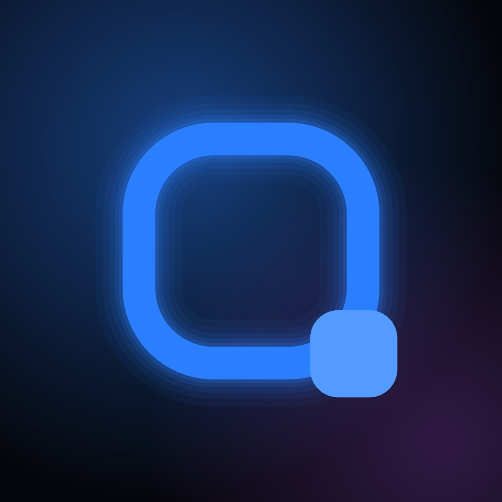
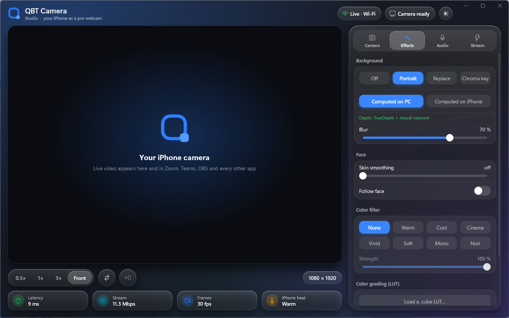
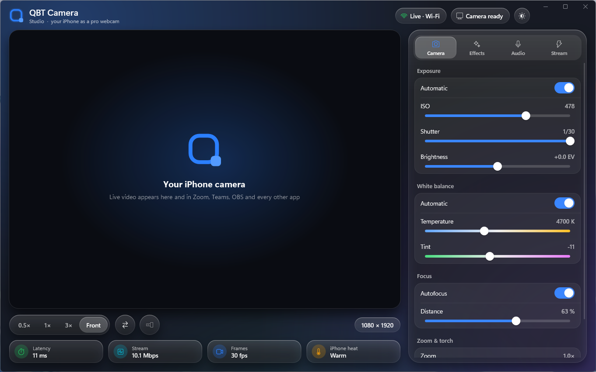
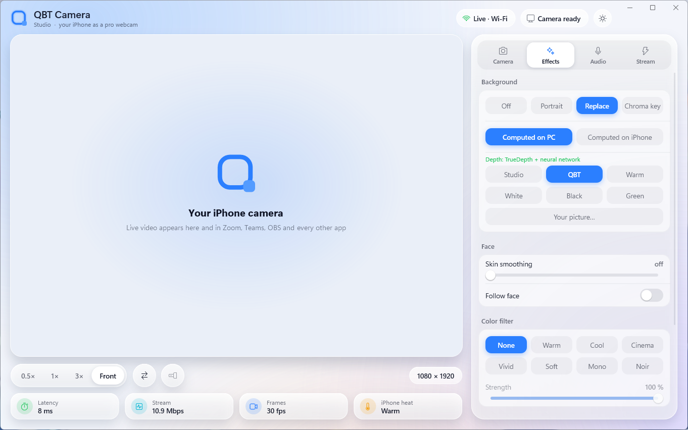
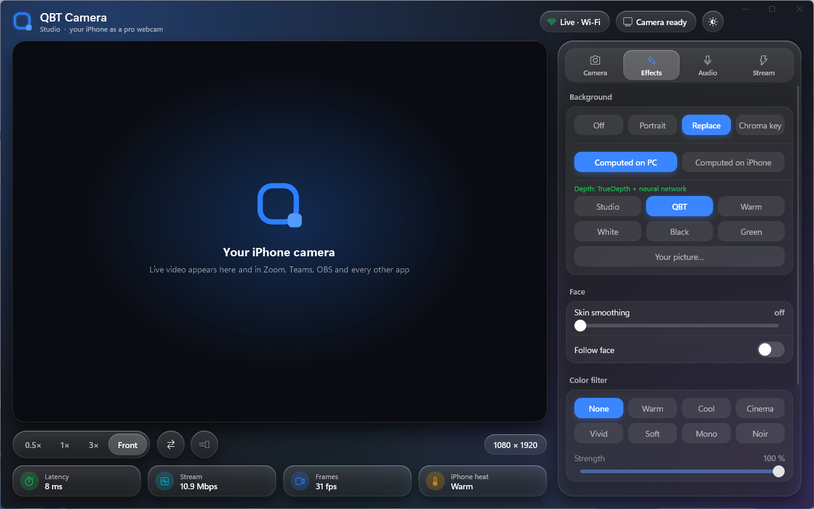
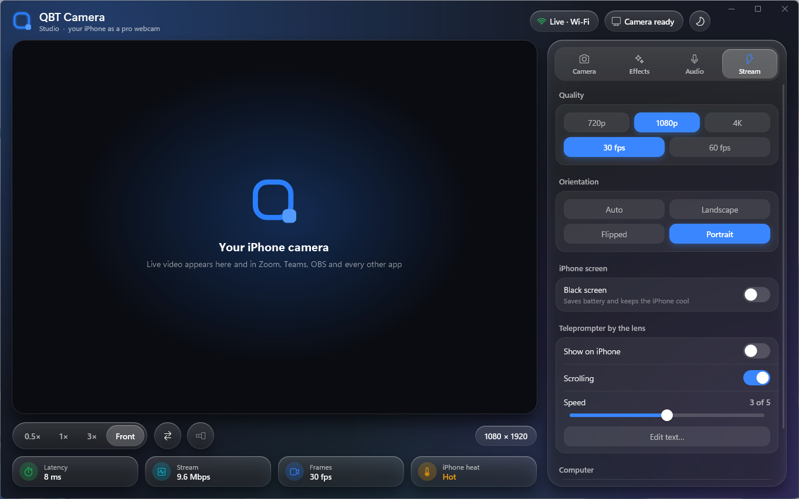
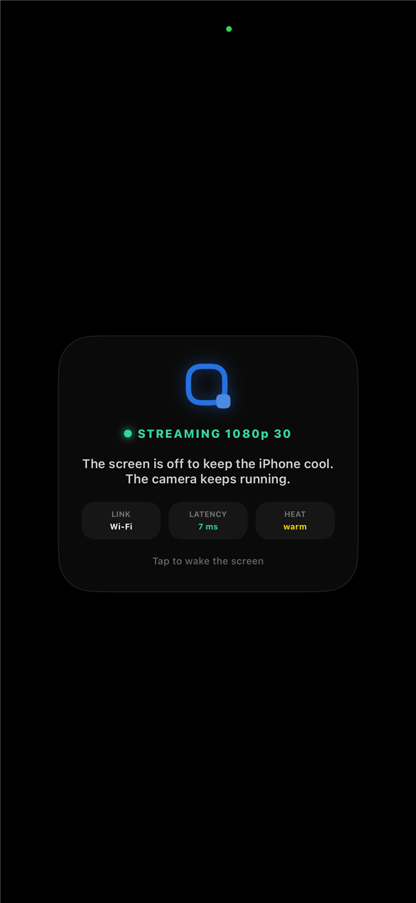

<p align="center">
  
</p>

<h1 align="center">QBT Camera</h1>

<p align="center">
  <b>Your iPhone as a professional webcam for Windows.</b><br>
  USB or Wi‑Fi · a few milliseconds of latency · real depth-based background blur (LiDAR / TrueDepth) ·
  full manual camera control · no watermark, no account, no cloud.
</p>

<p align="center">
  <a href="#download">Download</a> ·
  <a href="docs/MANUAL.md">Manual</a> ·
  <a href="#features">Features</a> ·
  <a href="#screenshots">Screenshots</a>
</p>

<p align="center">
  
</p>

---

## Why QBT Camera

The camera in your iPhone is far better than any laptop or USB webcam. QBT Camera brings it to every
Windows app — Zoom, Microsoft Teams, Google Meet, Discord, OBS, browsers — as a regular camera called
**“QBT Camera”**, the way Continuity Camera works on a Mac.

- **Looks like a real lens, not a cut-out.** Background effects use the iPhone’s **LiDAR scanner** and
  **TrueDepth** sensor together with Apple’s person segmentation: blur grows with distance, highlights
  turn into round bokeh, and the edge follows single hairs.
- **Uses your PC’s graphics card.** Edges are refined at full resolution and composited on the GPU of
  your computer — sharper results, and the iPhone stays cool. Or let the iPhone do it all.
- **Instant.** Hardware H.264 on both ends with a low-latency pipeline: a few ms over USB.
- **Yours to control.** ISO, shutter, white balance, focus, zoom, torch and lenses — from the computer.
- **Private.** Everything stays between your iPhone and your PC.

## Features

| | |
|---|---|
| 📷 **Pro camera** | All lenses (0.5×, 1×, telephoto, front), manual ISO / shutter / white balance / focus, zoom, torch, 720p · 1080p · 4K at 30/60 fps |
| 🌫️ **Portrait** | Depth-based lens blur with three blur levels and bokeh, adjustable strength |
| 🖼️ **Replace** | Clean cut-out on studio backdrops, your own picture, or broadcast green for OBS |
| 🟩 **Chroma key** | Automatic screen-color detection, edge softness, green-spill removal |
| 🎨 **Color** | Eight looks plus any `.cube` LUT (DaVinci Resolve, Premiere…) applied on the GPU |
| 🙂 **Face** | Skin smoothing and face-following framing |
| 📜 **Teleprompter** | Text scrolls right next to the front lens — read while looking into the camera; edit it on the PC |
| 🔌 **USB & Wi‑Fi** | Automatic discovery, switches to USB as soon as a cable is plugged in |
| 🎙️ **Audio** | iPhone microphone to the PC |
| 🌓 **Windows 11 design** | Mica, glass panels, light and dark themes, tray mode, starts with Windows |
| 🔋 **Cool and quiet** | Black-screen mode, lighter processing on hot or older iPhones |

## Screenshots

| Windows — dark | Windows — light |
|---|---|
|  |  |
| **Replace background** | **Stream settings & teleprompter** |
|  |  |

<p align="center">
  <br>
  <sub>iPhone: black-screen mode — the display is off, the camera keeps streaming.</sub>
</p>


## Download

**Windows:** get `QBTCamera-Windows-x.y.zip` from **[Releases](../../releases)**, unzip and run
**`Install QBT Camera.cmd`**. Details in the **[manual](docs/MANUAL.md)**.

**iPhone:** the App Store version is coming. Until then the app can be installed from source with a
free Apple ID — see [Install on iPhone](docs/MANUAL.md#3-install-on-iphone).

### Requirements

- **iPhone:** any model that runs **iOS 18 or later** (iPhone XS / XR and newer, iPhone SE 2nd gen and
  newer), up to iOS 27. LiDAR (Pro models) and Face ID (TrueDepth) give real depth; other cameras use
  the silhouette.
- **Windows:** Windows 10 or 11 (64‑bit) with a DirectX 11 GPU.
- **Connection:** the same Wi‑Fi network, or a USB cable with **Apple Devices** (Microsoft Store) installed.

## How it works

```
iPhone                                              Windows PC
 camera ─► effects ─► H.264 ─┐                    ┌─► GPU decode ─► background compositor ─► preview
 LiDAR / TrueDepth + person ─┤  USB (usbmux)      │      (D3D11 compute: guided filter,        │
   mask ─► matte stream ─────┼──── or Wi‑Fi ──────┤       depth blur, keying, LUT)             ▼
 microphone ─────────────────┘                    └─► audio              “QBT Camera” in every app
```

Only system frameworks are used — AVFoundation, VideoToolbox, Vision, Core Image and Metal on iOS;
Media Foundation, Direct3D 11, Direct2D, DirectComposition, WASAPI and WIC on Windows. No third-party
code.

Developer notes: [docs/DEVELOPMENT.md](docs/DEVELOPMENT.md).

## License

QBT Camera is **free for personal and commercial use as a webcam** (streams, calls, recordings).
The source code is **not** open source: copying, modifying or redistributing it, or publishing apps
built from it, is not allowed without permission. See [LICENSE](LICENSE) and [PRIVACY](PRIVACY.md).

---

<sub>Keywords: iPhone webcam for Windows, use iPhone as webcam PC, Continuity Camera for Windows,
iPhone virtual camera Windows 11, iPhone camera for Zoom / Teams / OBS, LiDAR background blur,
TrueDepth portrait webcam, green screen chroma key webcam, LUT webcam, teleprompter webcam,
Camo alternative, EpocCam alternative.</sub>
