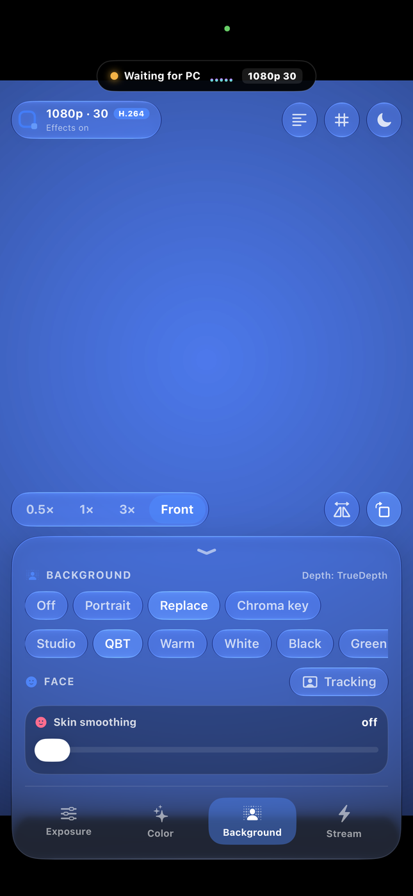
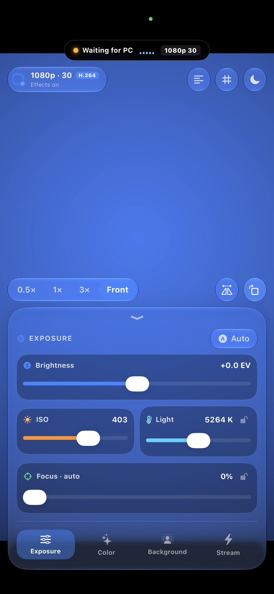
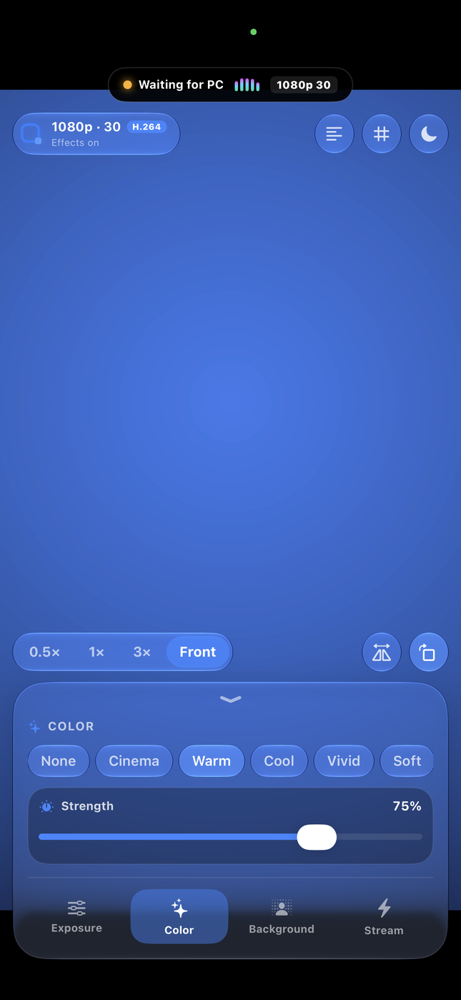
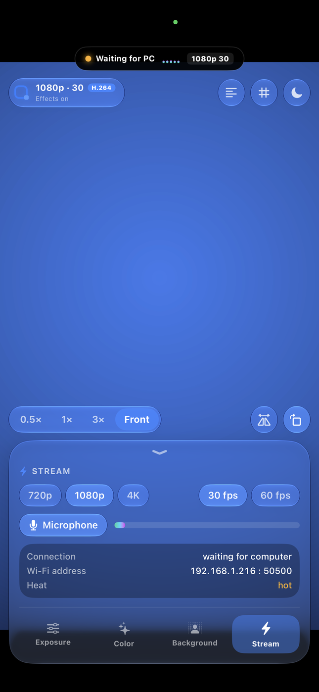
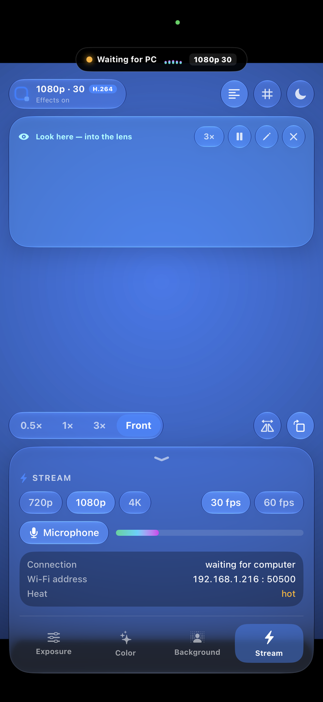

<p align="center">
  
</p>

<h1 align="center">QBT Camera</h1>

<p align="center">
  <b>Ваш iPhone як професійна веб-камера для Windows.</b><br>
  USB або Wi‑Fi · затримка у лічені мілісекунди · оптичне розмиття фону на основі датчиків глибини (LiDAR / TrueDepth) ·
  повне ручне керування камерою · без водяних знаків, без акаунтів, без хмари.
</p>

<p align="center">
  <b>🌐 Мова:</b> <a href="README.md">English</a> · <b>Українська</b>
</p>

<p align="center">
  <a href="https://github.com/qbt-studio/qbt-camera/releases/latest"></a>
  
  
  
</p>

<p align="center">
  <a href="#завантаження">Завантажити</a> ·
  <a href="docs/MANUAL.md">Інструкція</a> ·
  <a href="#можливості">Можливості</a> ·
  <a href="#скріншоти">Скріншоти</a>
</p>

<p align="center">
  
</p>

---

## Чому саме QBT Camera

Камера вашого iPhone значно перевершує будь-яку вбудовану веб-камеру ноутбука чи звичайну USB-камеру. QBT Camera інтегрує її у будь-яку програму для Windows — Zoom, Microsoft Teams, Google Meet, Discord, OBS, браузери — як стандартну камеру з назвою **«QBT Camera»**, так само безшовно, як працює Continuity Camera на комп'ютерах Mac.

- **Виглядає як справжній об'єктив, а не дешева вирізка.** Ефекти фону використовують апаратний **сканер LiDAR** та датчик **TrueDepth** разом з алгоритмами сегментації Apple: розмиття плавно посилюється з відстанню, відблиски перетворюються на красиве кругле боке, а краї м'яко огинають кожну волосинку.
- **Використовує відеокарту комп'ютера.** Уточнення меж у повній роздільній здатності та композитинг виконуються на GPU вашого ПК — картинка виходить чіткішою, а iPhone не нагрівається. Або ви можете довірити всю обробку iPhone.
- **Миттєва передача.** Апаратне кодування H.264 на обох пристроях із низькою затримкою: лічені мілісекунди через USB-кабель.
- **Повний ручний контроль.** ISO, витримка, баланс білого, фокус, зум, спалах та перемикання об'єктивів — прямо з комп'ютера.
- **Повна конфіденційність.** Усі дані передаються виключно між вашим iPhone та ПК без жодних сторонніх серверів.

## Можливості

| | |
|---|---|
| 📷 **Професійна камера** | Усі об'єктиви (0.5×, 1×, телеоб'єктив, фронтальна), ручні ISO / витримка / баланс білого / фокус, зум, ліхтарик, 720p · 1080p · 4K при 30/60 fps |
| 🌫️ **Портретний режим** | Оптичне розмиття на основі сенсорів глибини з трьома рівнями боке та регулюванням сили |
| 🖼️ **Заміна фону** | Акуратне відділення силуету на студійні фони, власні зображення або чистий зелений фон для OBS |
| 🟩 **Хромакей** | Автоматичне визначення кольору полотна, м'якість країв та усунення зелених рефлексів (spill removal) |
| 🎨 **Колірні луки та LUT** | Вісім кінематографічних пресетів плюс застосування будь-яких 3D `.cube` LUT файлів на GPU |
| 🙂 **Обличчя** | Розумне згладжування шкіри та кадрування зі стеженням за обличчям |
| 📜 **Телесуфлер** | Текст прокручується поруч із фронтальною лінзою — читайте текст, дивлячись прямо в очі співрозмовнику; редагування з ПК |
| 🔌 **USB та Wi‑Fi** | Автоматичне виявлення, миттєве перемикання на USB при підключенні кабелю |
| 🎙️ **Звук** | Передача мікрофона iPhone на комп'ютер |
| 🌓 **Дизайн Windows 11** | Mica, скляні панелі, світла та темна теми, робота в системному треї, автозапуск із Windows |
| 🔋 **Холодний і тихий** | Режим чорного екрана (Black Screen), що запобігає нагріванню батареї та дисплея при тривалих стрімах |

## Скріншоти

### Комп'ютер Windows

| Windows — темна тема | Windows — світла тема |
|---|---|
|  |  |
| **Заміна фону** | **Налаштування стріму та телесуфлер** |
|  |  |

### Мобільний додаток iPhone

| Фон та сенсори глибини | Ручне керування експозицією | Колірні луки та ретуш |
|:---:|:---:|:---:|
|  |  |  |
| **Розмиття глибини TrueDepth / LiDAR** | **Ручні ISO, витримка та баланс білого** | **Кінематографічні фільтри та гладка шкіра** |

| Параметри стріму та звук | Телесуфлер | Режим чорного екрана |
|:---:|:---:|:---:|
|  |  |  |
| **4K/1080p, рівень мікрофона та пінг** | **Погляд у камеру під час читання тексту** | **Екран вимкнено, потік продовжує йти** |

## Завантаження

| Платформа | Готовий файл | Альтернатива / Інсталятор |
|---|---|---|
| 🪟 **Windows** | **[QBTCamera.exe](release/QBTCamera.exe)** | **[QBTCamera-Windows-1.0.zip](release/QBTCamera-Windows-1.0.zip)** (інсталяційний архів) |
| 📱 **iOS** | **[QBTCamera.ipa](release/QBTCamera.ipa)** | Збірка з вихідного коду через Xcode (безкоштовний Apple ID) |

**Встановлення на Windows:** завантажте архів `QBTCamera-Windows-1.0.zip` (або перейдіть у **[Releases](../../releases)**), розпакуйте та запустіть **`Install QBT Camera.cmd`**. Також можна запускати **`QBTCamera.exe`** напряму. Деталі в **[інструкції](docs/MANUAL.md)**.

**Встановлення на iPhone:**
- **AltStore (Рекомендовано, Mac не потрібен):** завантажте **`release/QBTCamera.ipa`** і встановіть через **[AltStore](docs/MANUAL.md#option-a-install-via-altstore-windows--mac)** або **[Sideloadly](docs/MANUAL.md#option-b-install-via-sideloadly-windows--mac)**. Безкоштовно з будь-яким Apple ID; AltStore автоматично подовжує додаток по домашньому Wi‑Fi.
- **TrollStore:** завантажте `QBTCamera.ipa` і відкрийте через TrollStore (вічне встановлення, iOS 14–17.0).
- **З вихідного коду:** відкрийте `ios/QBTCamera.xcodeproj` в Xcode на Mac та натисніть Run — див. [Встановлення на iPhone](docs/MANUAL.md#option-d-build-from-source-code-with-xcode-mac-only).
- **App Store:** офіційна версія в магазині готується до релізу.

### Системні вимоги

- **iPhone:** будь-яка модель на базі **iOS 18 або новішої** (iPhone XS / XR та новіші, iPhone SE 2-го покоління та новіші), аж до iOS 27. Моделі з LiDAR (Pro) та Face ID (TrueDepth) забезпечують фізичну глибину сцени; інші моделі використовують сегментацію силуету.
- **Комп'ютер:** Windows 10 або 11 (64-біт) з відеокартою, що підтримує DirectX 11.
- **Підключення:** одна Wi‑Fi мережа, або USB-кабель із встановленим додатком **Apple Devices** (Microsoft Store) або iTunes.

## Як це працює

```
iPhone                                              Windows PC
 камера ─► ефекти ─► H.264 ──┐                    ┌─► декодування на GPU ─► композитинг фону ─► прев'ю
 LiDAR / TrueDepth + маска ──┤  USB (usbmux)      │        (D3D11 compute: guided filter,       │
   силуету ─► потік маски ───┼── або Wi‑Fi ───────┤         глибинне розмиття, кеїнг, LUT)      ▼
 мікрофон ───────────────────┘                    └─► звук                 «QBT Camera» у всіх програмах
```

Використовуються лише нативні системні фреймворки — AVFoundation, VideoToolbox, Vision, Core Image та Metal на iOS;
Media Foundation, Direct3D 11, Direct2D, DirectComposition, WASAPI та WIC на Windows. Жодних сторонніх важких бібліотек.

Примітки для розробників: [docs/DEVELOPMENT.md](docs/DEVELOPMENT.md).

## Ліцензія

QBT Camera є **безкоштовною для особистого та комерційного використання як веб-камера** (дзвінки, стріми, записи).
Вихідний код **не** є open source у сенсі вільного копіювання: копіювання, модифікація, перепродаж або публікація збірок без дозволу автора заборонені. Див. [LICENSE](LICENSE) та [PRIVACY](PRIVACY.md).

---

<sub>Ключові слова: iPhone як вебкамера для Windows, веб-камера з айфона на пк, Continuity Camera для Windows,
віртуальна камера Windows 11, камера iPhone для Zoom / Teams / OBS, LiDAR розмиття фону,
TrueDepth портретна вебка, хромакей зелений фон вебкамера, LUT вебкамера, телесуфлер,
альтернатива Camo, альтернатива EpocCam.</sub>
